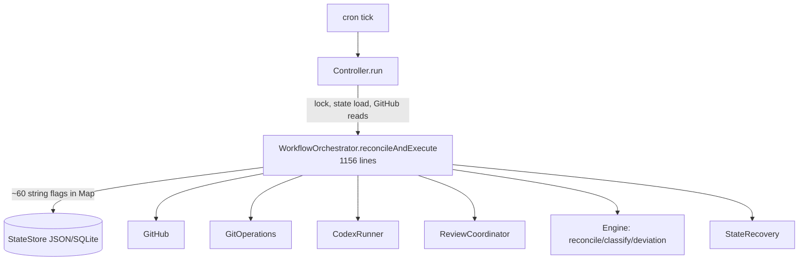
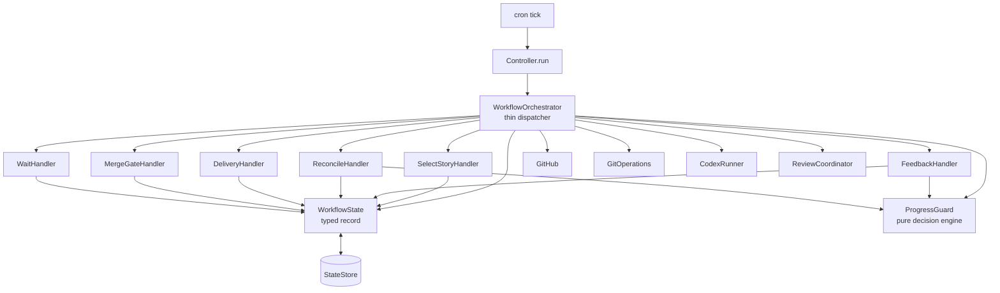
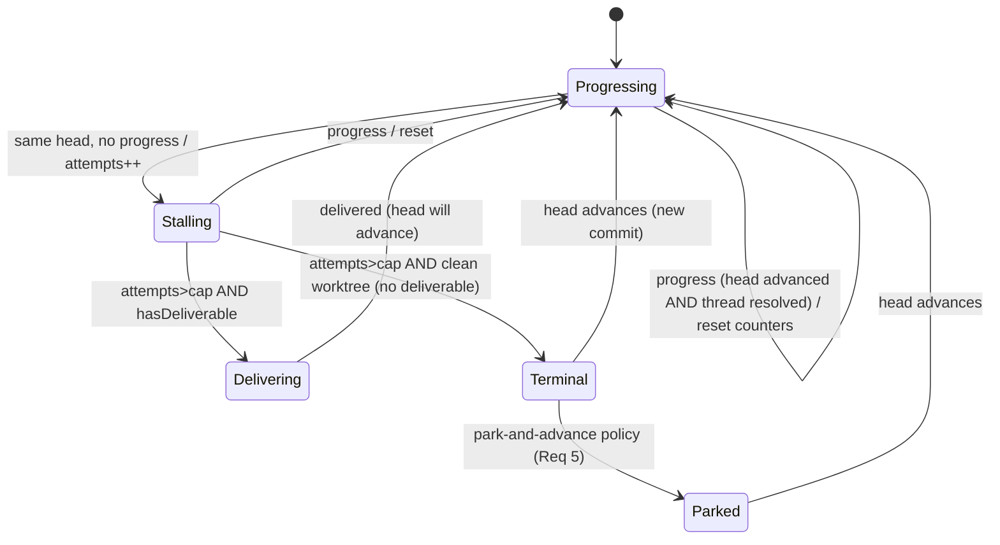

# Design Document

## Epic

- **Epic ID**: {To be assigned}
- **Status**: Draft
- **Related**: requirements.md (this spec)

## Overview

This design turns the controller's implicit, improvised control logic into an
explicit, testable architecture. The centerpiece is extracting all
anti-loop / progress / terminal decisions into a single pure component (the
**Progress Guard**) and decomposing the 1,156-line `reconcileAndExecute` into a
thin dispatcher plus per-phase handlers over a **typed workflow state**.

The refactor is behavior-preserving and incremental (characterize → extract →
verify parity per step).

## Current architecture (as-is, from code)



Problems (see requirements Introduction): all control logic concentrated in
`Orc`; anti-loop rules spread across ~6 sites; state is untyped and shared;
tests mock the boundaries but cannot isolate the control policy.

## Target architecture (to-be)



Each handler is small, receives the typed `WorkflowState` + injected
collaborators, returns a `PhaseOutcome` (next state + side-effect intents). The
dispatcher applies transitions declared by the state machine. Anti-loop
decisions live only in `ProgressGuard`.

## Components

### C1. WorkflowState (typed state model) — Requirement 3

Replaces control-relevant string flags with a typed record. Illustrative:

```java
record WorkflowState(
    Phase phase,
    Integer currentStory,
    PrRef currentPr,          // number, url, head, branch
    ProgressState progress,   // owned by ProgressGuard (see C2)
    ReviewState review,       // last processed ids, gate head, thread updates
    Set<Integer> completedStories,
    Map<Integer, ParkRecord> parkedStories,   // Requirement 5
    RecoveryState recovery
) { /* pure with-ers; single reset method for story-scoped fields */ }
```

- Loads from / saves to the existing `StateStore` JSON via an adapter that maps
  the legacy flat keys ↔ typed fields (backward compatible; unknown keys
  preserved).
- One `clearStoryScoped()` method is the single mutation point for story reset.

### C2. ProgressGuard (pure decision engine) — Requirements 4, 5

Owns the entire anti-loop / progress / terminal policy that caused every
regression this session. Pure and deterministic:

```java
enum GuardDecision { CONTINUE, DELIVER_TO_CI, TERMINAL_BLOCK, PARK }

record GuardInput(
    String currentHead,
    int resolvedThreadCount,   // durable progress signal
    boolean headAdvanced,
    boolean hasDeliverableChange,
    boolean deliveringMode,    // !dryRun && allow_push
    GuardConfig caps           // maxNoProgressPerHead, absoluteCeiling
) {}

final class ProgressGuard {
    ProgressState observe(ProgressState prior, GuardInput in); // updates counters
    GuardDecision decide(ProgressState state, GuardInput in);  // pure
}
```

Explicit state machine (replaces `stuck_head`, `stuck_head_reason`,
`resume_*`, `feedback_*`, `resume_total_resolved_baseline`):



Key invariant (fixes the PR #187 false-block): **progress resets counters;
counters only accrue on same-head no-progress.** `Terminal`/`Parked` require a
new head or operator action to leave — never cleared merely because delivery is
enabled.

### C3. Phase handlers — Requirement 2

One handler per phase, each < ~80 lines, returning a `PhaseOutcome`:

| Handler | Owns |
|---|---|
| `SelectStoryHandler` | story selection, PR adoption, dependency/eligibility, parked exclusion |
| `FeedbackHandler` | actionable feedback detection, dispatch decision (feedback vs reconcile via ProgressGuard) |
| `ReconcileHandler` | apply reconciliation decision, ProgressGuard `observe/decide` |
| `DeliveryHandler` | commit/push, verify head, reply+resolve threads, re-trigger review |
| `MergeGateHandler` | READY_TO_MERGE comment, auto_merge policy, manual-merge gate |
| `WaitHandler` | passive waits + poll backoff |

### C4. WorkflowMachine (transition table) — Requirement 1

A single declarative table: `phase → prompt`, `phase → legal next phases`,
`phase → handler`. The dispatcher consults it; illegal transitions throw a
detectable error. This is the "one-page state machine".

### C5. Controller (unchanged responsibilities) — preserved

Scheduling, lock/watchdog, job-control gate, waiting-phase backoff,
skip-dedupe, GitHub read gating, merge gate remain as today.

## Data model / migration — Requirement 3

- New `WorkflowStateCodec`: maps legacy flat JSON keys ↔ typed `WorkflowState`.
- Legacy keys retired from control logic: `stuck_head`, `stuck_head_reason`,
  `resume_guard_head`, `resume_attempts`, `resume_total_story`,
  `resume_total_attempts`, `resume_total_resolved_baseline`,
  `feedback_guard_head`, `feedback_attempts`, `last_feedback_result`,
  `last_feedback_result_head`, `feedback_reconcile_pending` → folded into
  `ProgressState` + `ReviewState`.
- On load, unknown/legacy keys are read into the typed model where mapped and
  otherwise preserved verbatim (no data loss).

## Error handling

- Each handler returns typed outcomes; exceptions map to explicit phases
  (`BLOCKED_EXTERNAL`, `CONFLICT_DETECTED`) — never silent.
- Lost lock → `LockOwnershipLost` → clean INFO end (already implemented).
- ProgressGuard never throws; unknown inputs default to `CONTINUE` (fail toward
  progress, bounded by caps).

## Testing strategy — Requirement 7

- **Unit (pure):** `ProgressGuardTest` enumerates every transition; each phase
  handler tested with typed inputs, no mocks.
- **Codec:** `WorkflowStateCodecTest` round-trips legacy JSON ↔ typed state.
- **End-to-end (offline):** `WorkflowE2EHarness` runs N full ticks against a
  scripted fake `gh` + fake `codex`; scenarios reproduce field logs.
- **Characterization:** capture current `reconcileAndExecute` outcomes for key
  scenarios before refactor; re-run after each extraction to prove parity.

### Test scenarios (Given-When-Then)

- **TS-1 (Validates R4):** *Given* a PR that advances its head and resolves a
  thread each round, *When* many rounds run, *Then* ProgressGuard never returns
  TERMINAL_BLOCK (counters reset on progress).
- **TS-2 (Validates R4):** *Given* the same head retried past the cap with no
  thread resolved and a clean worktree, *When* observed, *Then* ProgressGuard
  returns TERMINAL_BLOCK exactly once and CONTINUE→same is not re-entered.
- **TS-3 (Validates R4):** *Given* same head past cap with a dirty worktree,
  *When* observed, *Then* decision is DELIVER_TO_CI.
- **TS-4 (Validates R5):** *Given* a TERMINAL_BLOCK under park policy, *When*
  the next tick runs, *Then* the story is parked, excluded from selection, and
  the next eligible story is selected.
- **TS-5 (Validates R5):** *Given* a parked story whose head later advances,
  *When* observed, *Then* it is un-parked and resumes.
- **TS-6 (Validates R1):** *Given* an illegal phase transition, *When*
  dispatched, *Then* a detectable error is raised (not silent).
- **TS-7 (Validates R3):** *Given* a legacy `epic-<n>.json`, *When* loaded and
  saved, *Then* control state round-trips with no data loss.
- **TS-8 (Validates R2/R8):** *Given* the characterization suite, *When* run
  before and after each extraction, *Then* outcomes are identical.
- **TS-9 (Validates R6):** *Given* a stable terminal state, *When* many ticks
  run, *Then* no repeated identical ERROR/flood lines are emitted (deduped).
- **TS-10 (Validates R7):** *Given* the E2E harness replaying the PR #187
  lifecycle (~40 heads, ~200 resolutions), *Then* the story completes/holds
  correctly without a false terminal block.

## Sequencing (high level)

1. Characterization tests (safety net) →
2. Extract ProgressGuard (highest fragility, biggest win) →
3. Introduce typed WorkflowState + codec →
4. Extract phase handlers + WorkflowMachine →
5. E2E harness →
6. Optional FR-5 park-and-advance (config-gated).

## Risks and mitigations

- **Behavior drift during refactor** → characterization tests + parity gate per
  step (R8).
- **State migration bugs** → codec round-trip tests on real legacy files (TS-7).
- **Scope creep into features** → explicitly out of scope (requirements).
- **Big-bang temptation** → enforced incremental steps, each independently
  green.
