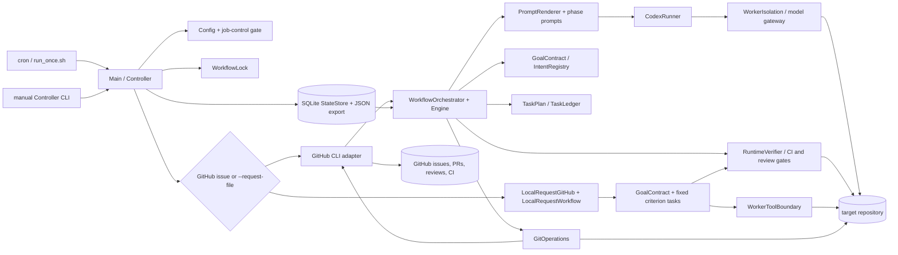

# Current architecture — 2026-10-18

## Scope and evidence standard

This audit describes the **current working tree**, including extensive pre-existing uncommitted changes. Source code and checks run on 2026-10-18 are evidence; README claims and prompt instructions are labelled as intentions. The program is a scheduled GitHub epic/story coding workflow with a second, file-based local-request route. It is not a general conversational coding agent. The example configuration is observational (`dry_run: true`, mutations disabled) and has no verification commands, so it cannot deliver a verified change as supplied [config/config.json.example:17,130-171](../config/config.json.example).

## Runtime and components

- Java 21 with Gradle application, Checkstyle, JUnit 5/AssertJ, Jackson, SQLite JDBC, SLF4J/Logback [build.gradle:1-31](../build.gradle). Python 3 scripts implement the optional isolation gateway; Bash scripts launch the job. The `codex` CLI, `gh`, `git`, Java, Gradle and isolation prerequisites are host dependencies, rather than Gradle libraries.
- `Main.main` calls `Controller.run`; the controller loads/validates config, applies the job-control gate, acquires an epic lock, opens SQLite state, and recovers abandoned jobs [Controller.java:194-245](../src/main/java/com/jcoding/workflow/Controller.java), [Controller.java:296-456](../src/main/java/com/jcoding/workflow/Controller.java). Default intake reads a configured GitHub epic and PRs; `--request-file` selects a separate local JSON request path without GitHub CLI. Other operational CLI paths include `--force-run`, `--readiness`, `--provider-canary`, `--list-effects`, and `--retry-effect`. The scheduled entry is `scripts/run_once.sh` via `scripts/cron-launcher.sh`; `install-cron.sh` was inspected but not run.
- `Engine` selects linked stories and classifies PR/CI/review state [Engine.java:79-207](../src/main/java/com/jcoding/workflow/Engine.java), [Engine.java:212-260](../src/main/java/com/jcoding/workflow/Engine.java). `WorkflowOrchestrator` is the main coordinator: story adoption, dependency checks, clarification, planning, phase dispatch, recovery, review, verification, push and PR delivery [WorkflowOrchestrator.java:127-225](../src/main/java/com/jcoding/workflow/WorkflowOrchestrator.java), [WorkflowOrchestrator.java:724-1080](../src/main/java/com/jcoding/workflow/WorkflowOrchestrator.java).
- The configured model is invoked with `codex exec --json`; `CodexRunner` parses events, usage and the final agent message. In the GitHub route, normal edit/planning phases append a `WorkerToolBoundary` protocol, ask Codex to run read-only, validate proposed file operations and let controller code apply them; review and reconcile calls are read-only [WorkflowOrchestrator.java:2471-2569](../src/main/java/com/jcoding/workflow/WorkflowOrchestrator.java), [CodexRunner.java:131-149](../src/main/java/com/jcoding/workflow/CodexRunner.java). Local requests also use read-only structured proposals and controller-applied edits [LocalRequestWorkflow.java:236-311](../src/main/java/com/jcoding/workflow/LocalRequestWorkflow.java). Investigation still relies on Codex's own read-only shell/filesystem tools inside its sandbox; the controller mediates edits and remote actions, not every observation/tool call. Prompts combine `prompts/common.md`, a phase prompt and serialized controller context.
- State is per epic in SQLite, with a JSON export; it includes current story/PR, phase, goals, plan/ledger, budgets, evidence, review findings, jobs and external effect records. `WorkflowLock` limits overlapping ticks. GitHub and Git remote are the external queue and delivery surface. There is no separate broker or service process.
- `ActionPolicy`, `DeploymentPolicy`, `GitOperations` protected paths, `WorkerIsolation`, `RuntimeVerifier`, and `EffectJournal` provide distinct gates. They are partial boundaries; details and residual risks are in [02-gap-analysis.md](02-gap-analysis.md).

## Representative GitHub coding task, as actually dispatched

1. A cron tick starts `Controller.run`; the job gate and lock decide whether work may start. A dry run with no PR only observes selection [Controller.java:233-299](../src/main/java/com/jcoding/workflow/Controller.java), [WorkflowOrchestrator.java:151-161](../src/main/java/com/jcoding/workflow/WorkflowOrchestrator.java).
2. The controller reads the configured epic, linked stories and PRs. `selectAndAdoptStory` prefers an existing open PR or selects an eligible issue; it fetches the current story, captures a goal contract, checks clarification and dependencies [Controller.java:414-449](../src/main/java/com/jcoding/workflow/Controller.java), [WorkflowOrchestrator.java:1529-1718](../src/main/java/com/jcoding/workflow/WorkflowOrchestrator.java).
3. Worktree preparation recovers/checks out the story branch and checks dirty-tree conditions. Optional planning dispatches `plan.md`, validates a JSON task DAG and stores the task ledger [WorkflowOrchestrator.java:754-806](../src/main/java/com/jcoding/workflow/WorkflowOrchestrator.java), [WorkflowOrchestrator.java:913-944](../src/main/java/com/jcoding/workflow/WorkflowOrchestrator.java).
4. The selected phase prompt receives epic, story, goal, active task, PR, current state and recovery observations. The model runs read-only, returns a structured proposal, and the controller checks the request identity, source fingerprint, criteria attribution, paths and file preconditions before applying it [WorkflowOrchestrator.java:841-910](../src/main/java/com/jcoding/workflow/WorkflowOrchestrator.java), [WorkflowOrchestrator.java:2471-2569](../src/main/java/com/jcoding/workflow/WorkflowOrchestrator.java), [WorkerToolBoundary.java:91-167,170-287](../src/main/java/com/jcoding/workflow/WorkerToolBoundary.java). The resulting controller footer is then parsed into state [Engine.java:726-824](../src/main/java/com/jcoding/workflow/Engine.java).
5. A successful task requires controller-run executable checks before the ledger marks it verified. Story delivery additionally requires `RuntimeVerifier` to run configured checks, cover criterion IDs, enforce path scope, and bind proof to a source fingerprint, goal hash and policy hash [WorkflowOrchestrator.java:1082-1123](../src/main/java/com/jcoding/workflow/WorkflowOrchestrator.java), [RuntimeVerifier.java:34-95](../src/main/java/com/jcoding/workflow/RuntimeVerifier.java).
6. If mutation flags allow it, `GitOperations` commits/pushes; the controller reads back local, origin and PR head, creates a PR when needed, and may post/reconcile review threads. CI and review classification decide later ticks. Merge is manual by default; configured auto-merge has a separate proof and GitHub gate [WorkflowOrchestrator.java:1126-1350](../src/main/java/com/jcoding/workflow/WorkflowOrchestrator.java), [WorkflowOrchestrator.java:1790-1950](../src/main/java/com/jcoding/workflow/WorkflowOrchestrator.java).

## Local request route

`--request-file` requires a positive configured epic number; the file becomes one synthetic story at `epic + 1`. It must contain a title and explicit criterion IDs/text. The controller stores the same goal contract and durable state, creates a sibling worktree, creates one sequential task per criterion (it does not ask a planner to decompose the request), runs a read-only Codex worker that proposes file operations, applies them through `WorkerToolBoundary`, executes configured criteria-mapped checks, and writes a local delivery artifact [Controller.java:246-249,410-456](../src/main/java/com/jcoding/workflow/Controller.java), [LocalRequestGitHub.java:24-65](../src/main/java/com/jcoding/workflow/LocalRequestGitHub.java), [LocalRequestWorkflow.java:52-149,202-233,236-311,369-438](../src/main/java/com/jcoding/workflow/LocalRequestWorkflow.java). This is a bounded coding workflow, but the JSON file is not an authenticated interactive conversation channel; the example config prevents execution because it is dry-run with no checks.

## Failure and lifecycle semantics

Worker calls have phase deadlines, per-story call/time/token accounting, bounded feedback/reconcile attempts, and failure evidence [ExecutionBudget.java:19-82](../src/main/java/com/jcoding/workflow/ExecutionBudget.java), [WorkflowOrchestrator.java:605-722](../src/main/java/com/jcoding/workflow/WorkflowOrchestrator.java). A changed source/goal/policy invalidates task proof. `job-control.json` is checked during worker heartbeats and before mutations [ActionPolicy.java:16-57](../src/main/java/com/jcoding/workflow/ActionPolicy.java). SQLite state uses optimistic version checks; abandoned jobs and uncertain external effects are reconciled on restart. This provides duplicate protection and read-back, not a distributed exactly-once transaction [StateStore.java:312-389](../src/main/java/com/jcoding/state/StateStore.java), [EffectJournal.java:25-50](../src/main/java/com/jcoding/state/EffectJournal.java).

## Coverage inventory and exclusions

All first-party production Java modules in `workflow`, `github`, and `state` were inspected across the core, intent, and security reviews; the 3,032-line `WorkflowOrchestrator` was inspected by route and relevant full methods. All Java test files were inventoried and executed by JUnit; tests central to worker boundaries, state/recovery, workflow delivery, intents and launch were read in detail, but not every test assertion was manually reviewed. All prompt files were inventoried; `common.md`, `plan.md`, `implement.md`, `verify.md`, `reconcile.md`, review prompts, and shared rendering paths were inspected, while lower-risk prompt variants were spot-checked. Build/settings/wrapper metadata, CI, example config, Checkstyle, scripts, Python isolation resources, README and autonomy design doc were inspected. Excluded generated `build/`, `out/`, `.gradle/`, dependency caches, wrapper binary internals, `.git/`, logs, runtime backups/state, and vendored code. No secret values were opened or reported. No live target repository, GitHub account, provider, cron install, or production job was exercised.

## Evidence labels

**Implemented:** source path executes the described behavior. **Verified:** a named local check actually passed. **Documented:** only README/prompt/config claims it. **Inferred:** behavior follows code but was not exercised end to end. **Unknown:** requires external credentials, service, target repo or fault test. The current audit cannot claim reliable unattended completion of a representative real GitHub story.
