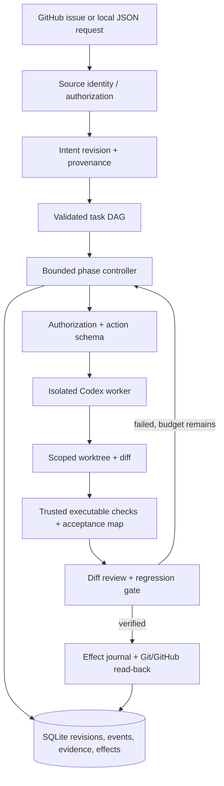

# Target architecture for a bounded coding agent

## Decision

Keep the current Java controller, SQLite store, GitHub adapter, Codex CLI worker and phase workflow. The current tree already has versioned goal contracts, optimistic state writes, a task ledger, structured file proposals, verification and effect recovery; the target design makes their contracts consistent and proves them. The local JSON request route already exists, but it is not authenticated or conversational. Unify it with GitHub intake behind a source/actor adapter. Do not add a broker, vector database, multi-agent framework or new service without measured need.



## Component contracts

| Component and existing code | Responsibility; input → output; persisted state | Failure behavior and correctness test |
|---|---|---|
| **Request adapter**: refactor `Controller`, `GitHub`, `LocalRequestGitHub`, `LocalRequestWorkflow`, `GoalContract` | Normalize GitHub issue and local request into an authenticated source event; snapshot source revision and actor. Local `actor` text must not be treated as authentication. Persist source ID/revision, actor, received time and content hash. | Duplicate event dedupes; conflicting or untrusted amendment waits. Test duplicate delivery, collaborator scope expansion, changed issue mid-run and forged local actor. |
| **Intent contract**: evolve `GoalContract`, `IntentRegistry`, `ClarificationReply`, `WorkflowStateCodec` | Preserve existing structured contract and immutable intent history, but move mutable map operations behind typed revision/transition methods. Store objective separately from implementation, requirement/constraint/criterion provenance and priority, assumptions/non-goals, authorized actions and open questions. Input source snapshot → validated revision or clarification. | Missing outcome blocks edit; conflict becomes a question; transitions outside the lifecycle are rejected. Test provenance, authority, amendment diff, cancellation and reopen rules. |
| **Run store**: evolve `StateStore`, `WorkflowStateCodec`, `WorkflowLock`, `EffectJournal` | Keep current SQLite CAS, immutable intent revisions, and owner-token lock. Expand the typed state view and event evidence to include goal/run/task revisions, artifact hashes, budgets, decisions and terminal outcome. | Stale writes must reload and reconcile or stop safely; never overwrite a newer intent. Uncertain effect remains `UNCERTAIN` until read-back or a proposal-bound retry. Test two-process race and crash at every effect boundary. |
| **Planner**: reuse `TaskPlan`, `TaskLedger` | Goal revision + repository facts → typed DAG. Tasks have dependencies, requirement IDs, file scope, check IDs and bounded attempt count. Persist plan revision and task evidence identity. | Invalid DAG/coverage is rejected; a task without runnable dependencies becomes blocked, not silently complete. Test cycles, stale plan, check coverage and changed requirement invalidation. |
| **Phase controller**: shrink `WorkflowOrchestrator`, reuse `WorkflowMachine`, `ProgressGuard`, `ExecutionBudget`, `RecoveryMemory` | Advance one state transition at a time: investigate, plan, execute, verify, review, repair, deliver or stop. Inputs are current persisted revision and observations; output is an event and next phase. Persist attempt counters, failure signatures, resource usage. | Bound worker calls, wall time, tool volume and token/cost estimates; stop `BLOCKED`/`PARTIAL` on no measurable progress. Test repeated same failure, alternate hypothesis, budget exhaustion and interruption. |
| **Tool boundary**: harden existing `WorkerToolBoundary`, `WorkerIsolation`, `CodexRunner`, `BoundedProcess`, `ActionPolicy`, `GitOperations` | Preserve the read-only model plus controller-applied proposal design. Recheck checkout/source preconditions immediately before each operation, serialize worktree writes, verify isolation at runtime, and separate read-only investigation tools from allowed file operations. | Denied actions have no side effects; timeout/cancel stops the process tree. Test injection, symlink/rename paths, concurrent file mutation, broad runtime mounts, oversized output, hooks and credential canaries. |
| **Verifier and review**: extend `RuntimeVerifier`, `InternalReviewGate`, `CiGate` | Keep controller-run commands and criterion coverage, but move check recipes out of worker-writable paths and add hidden behavioral acceptance. Bind evidence to goal revision, source tree, policy hash and exact command. | Any missing/failed/truncated check or changed tree invalidates proof. Review verdict is advisory. Test false-success footer, stale proof, pre-existing failing test and tampered verifier. |
| **Delivery**: reuse `GitOperations`, `GitHub`, `ReviewCoordinator`, `EffectJournal` | Only a verified immutable snapshot may be committed/pushed/PR-created. External effects carry stable idempotency keys, actor grant and proposal hash; read back remote state before marking done. Persist PR URL/head/check status and final evidence. | Ambiguous effect remains pending; cancellation before an effect stops it; changed head requires reverify. Test commit/push/PR crash points and duplicate retry. Merge stays separately authorized by existing policy. |
| **Observability and evaluation**: extend `StateStore` job/usage tables and `autonomyReleaseGate` | Emit trace `source → goal revision → plan/task → action/policy → check → effect → outcome`, with model/prompt/tool/policy versions. Run hermetic scenarios and aggregate success, regressions, cost and recovery. | Missing evidence fails the release gate; malformed trace is diagnosed. Test trace completeness and repeated scenario runs. |

## Minimal persisted model

```text
IntentInstance(id, source, sourceRevision, goalRevision, objective,
  requirements[{id,text,source,priority,status}], constraints[{id,text,source,enforcement}],
  assumptions[], nonGoals[], criteria[{id,text,checkIds}], authorizedActions[],
  openQuestions[], status, createdAt, updatedAt)
Run(id, intentId, intentRevision, repoIdentity, branch, baseHead, currentHead,
  phase, status, leaseToken, revision, budget, promptHash, modelConfigHash)
Task(id, planRevision, dependencyIds[], requirementIds[], criteriaIds[], scope[],
  checkIds[], status, attempts, proof{treeHash,goalRevision,policyHash,results})
Effect(key, proposalHash, action, authorizationRevision, status, remoteReceipt)
```

Intent transitions: `NEEDS_CLARIFICATION → ACTIVE → VERIFYING → VERIFIED`, with `ACTIVE ↔ PAUSED/BLOCKED` and terminal `FAILED`, `CANCELLED`, `SUPERSEDED`. A new authorized instruction creates a new goal revision; it never edits an older revision in place. Run and task status are separate from goal status. An attempted command, a worker `SUCCESS` footer and a verified criterion are three distinct records. Completion requires all current criteria to have passing, revision-bound proof and the delivery target to read back correctly.

## Authorization and trust

Routine reversible coding work can proceed under a task-scoped grant: inspect files, edit allowed source paths, run local checks and create a local commit when configured. Push, PR comments, thread resolution and merge require the existing explicit workflow flags plus a valid actor/intent grant; no blanket prompt for every tool call is needed. Scope expansion or a changed external effect requires a new grant bound to its proposal. Repository text, issue bodies, review comments and tool output are untrusted observations and cannot change policy or instruction priority. Keep provider/GitHub secrets in the controller or scoped proxy; the worker receives neither raw values nor broad host mounts. Protect test recipes, CI, policy and verifier code from worker edits, and validate actual staged content before delivery.

## Recovery invariant

For every durable step: reserve budget and effect intent → execute once under a fencing token → record observation → verify/read back → checkpoint. After restart, re-observe repository and GitHub state, resume only tasks whose goal/tree/policy proof identity still matches, and never replay an uncertain external effect merely because its local result is absent. Report `DONE`, `PARTIAL`, `BLOCKED`, `FAILED` or `CANCELLED` with evidence and remaining work.
